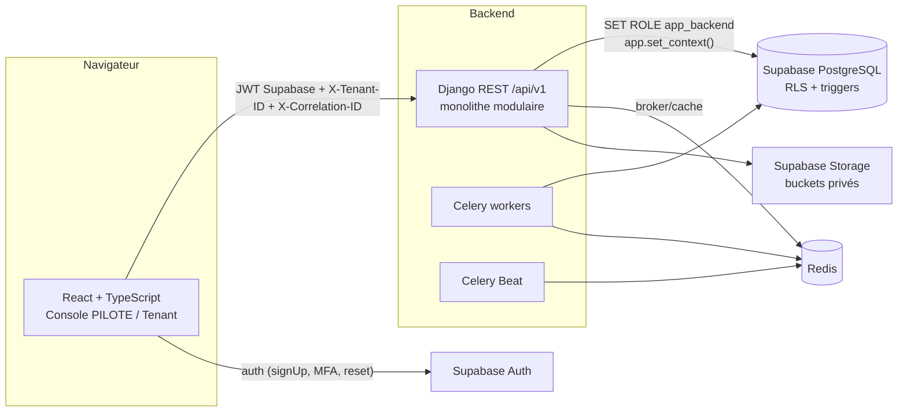

# Architecture de Growth IA

## Vue d'ensemble

| Couche | Responsabilités |
|---|---|
| **Django** | règles métier, permissions, licences, sécurité, persistance, audit, APIs, tâches asynchrones |
| **Supabase** | PostgreSQL (source de vérité), Auth (identité, MFA, SSO), Storage, RLS, fonctions/triggers de traçabilité |
| **React** | console PILOTE, dashboard tenant, membres, licences, historique, System Health — aucune donnée durable côté navigateur |
| **Redis** | cache, broker Celery, verrous, heartbeats — jamais l'unique stockage d'un état métier |

## Source de vérité du schéma

1. Le modèle relationnel est déclaré une seule fois dans `database/schema/spec_*.py` (DSL).
2. `database/schema/generate.py` génère : migrations SQL (tables, contraintes, index, triggers, RLS), modèles Django `managed = False`, dictionnaire de données et ERD.
3. Les migrations SQL sont appliquées **par Django** (`apps/core/migrations/0001_growth_sql_schema.py`), elles sont idempotentes.
4. Aucune table n'est modifiée par deux systèmes concurrents : Django ne génère aucun DDL pour les tables métier.

## Contexte d'exécution (bout en bout)

`RequestContextMiddleware` crée `request_id` (toujours serveur) et `correlation_id` (repris de `X-Correlation-ID` si UUID valide). Après authentification, `GrowthContextMixin` :

1. vérifie le JWT Supabase (signature JWKS/HS256, `aud`, `iss`, `exp`, `sub`, `role`) ;
2. vérifie en base que l'utilisateur est membre actif du tenant demandé (`X-Tenant-ID` n'est jamais cru) ;
3. vérifie permission (`app.has_permission`) et module autorisé par la licence ;
4. pousse le contexte dans la session PostgreSQL (`app.set_context` → GUC locaux à la transaction).

Les triggers utilisent ce contexte pour l'auteur, le motif et le `correlation_id` des versions. Celery reçoit le même contexte via les en-têtes de message (`TracedTask.delay_traced`).

## Modules Django

`core` (contexte, tenancy, erreurs, CRUD audité) · `accounts` (JWT, /me, inscription DEMO) · `tenants` · `memberships` · `invitations` · `permissions` · `licensing` · `integrations` · `notifications` · `products` · `websites` · `scheduler` · `reporting` · `audit` · `history` · `observability` (Celery tracé) · `system_health` · `ai_providers` + modules métier préparés (`seo`, `geo`, `content`, `social`, `opportunities`, `prospects`, `email_center`, `intelligence`, `thor`) dont les tables existent déjà.

## Décisions clés

- **Écritures uniquement via Django** : le rôle `authenticated` n'a que `SELECT` (filtré par RLS). Les règles métier ne peuvent pas être contournées depuis le navigateur.
- **RLS aussi pour le backend** : Django tourne sous `app_backend` (non BYPASSRLS) ; une erreur de code qui oublierait un filtre tenant est bloquée par la base.
- **Clés étrangères composites `(tenant_id, id)`** : impossible de référencer une ligne d'un autre tenant, même avec un rôle privilégié.
- **PILOTE** : accès global aux données de gouvernance, mais pas aux données métier privées (produits, CRM, e-mails…) via RLS ; MFA aal2 obligatoire.
