# ERD

> GENERATED by database/schema/generate.py — DO NOT EDIT BY HAND

One Mermaid diagram per domain (relations to `tenants` and `auth.users` omitted for readability).

## A. Identité et utilisateurs

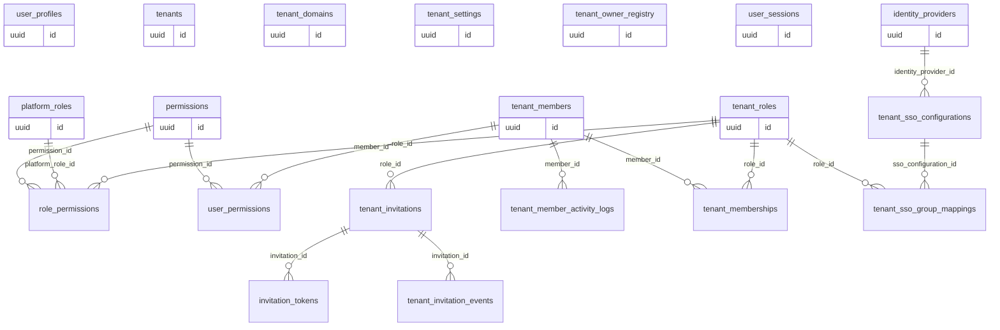

## B. Licences

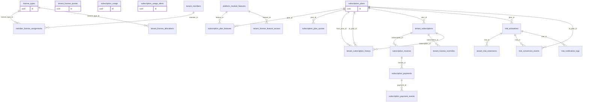

## C. Autorisations

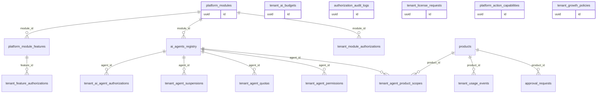

## D. Connecteurs

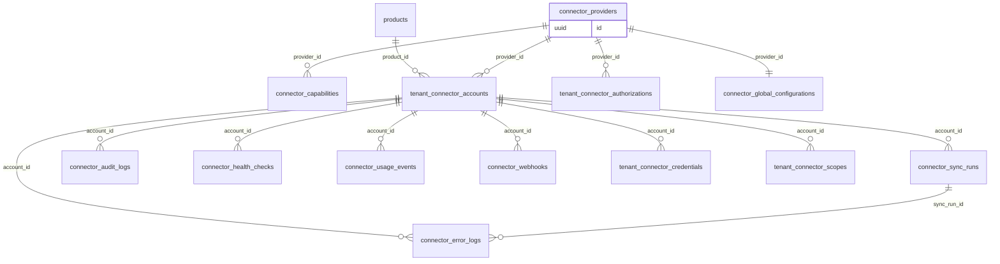

## E. Produits et sites web

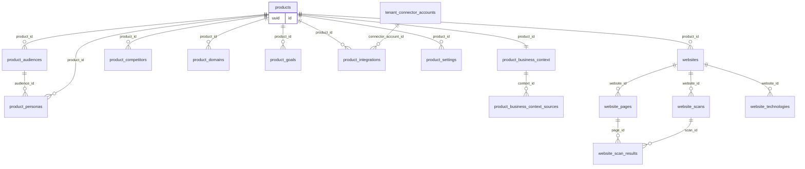

## M. Scheduler et workflows

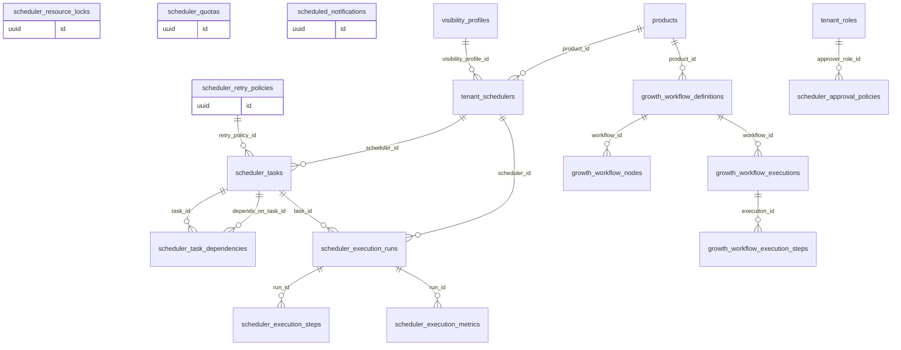

## P. Reporting

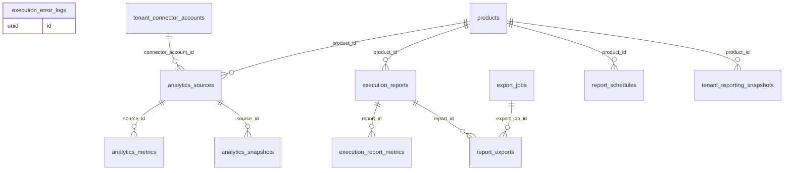

## Q. Notifications

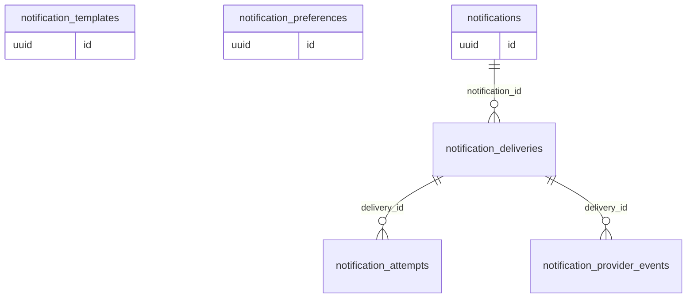

## R. System Health

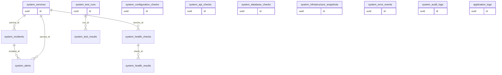

## S. Fournisseurs IA

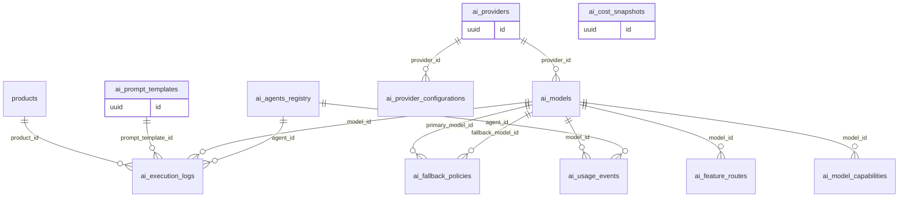

## Traçabilité

```mermaid
erDiagram
    audit_events { uuid id }
    activity_events { uuid id }
    execution_logs { uuid id }
    audit_log_corrections { uuid id }
    data_retention_policies { uuid id }
    data_deletion_requests { uuid id }
    export_jobs { uuid id }
    record_access_logs { uuid id }
    idempotency_keys { uuid id }
    entity_history { uuid id }
```

## F. SEO

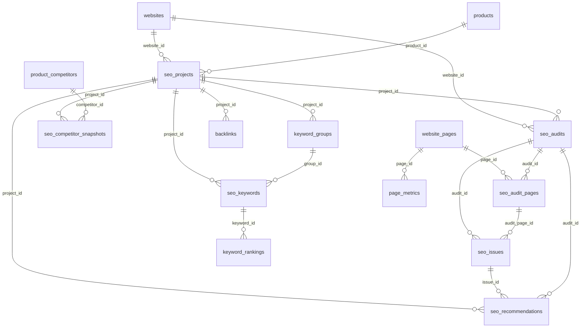

## G. GEO

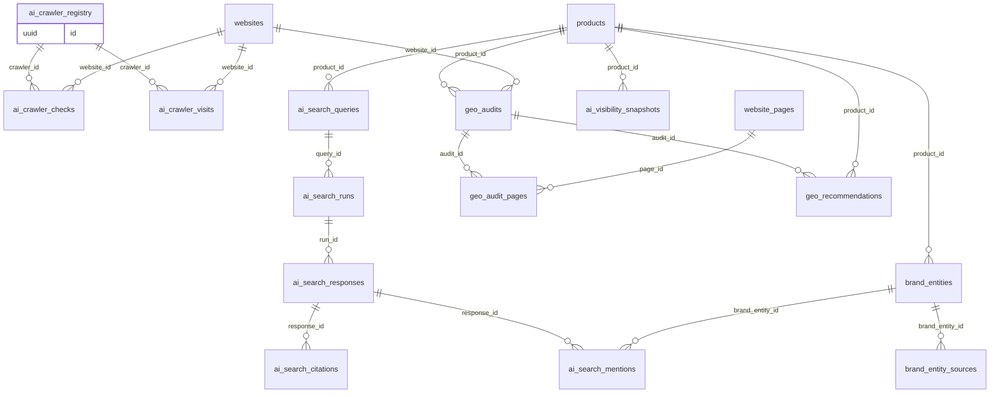

## H. Content

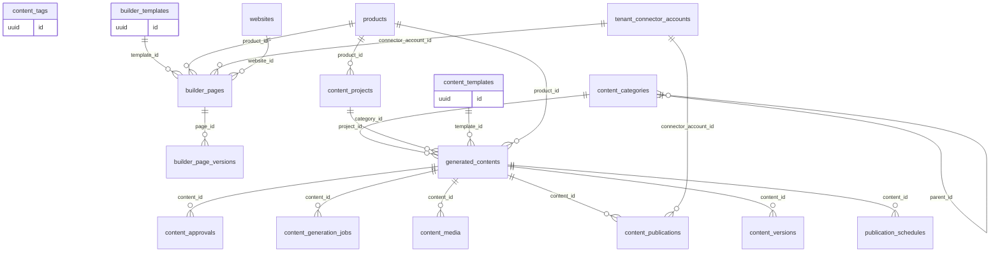

## I. Social et vidéos

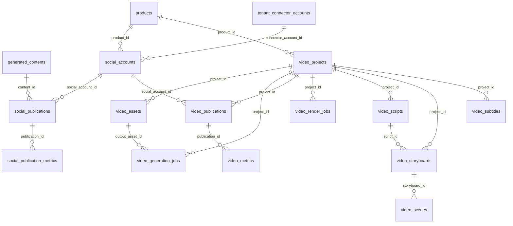

## J. Opportunity Hunter

```mermaid
erDiagram
    opportunity_sources { uuid id }
    opportunity_scores { uuid id }
    opportunity_actions { uuid id }
    opportunity_followups { uuid id }
    opportunity_outcomes { uuid id }
    opportunity_alerts { uuid id }
    opportunity_scores ||--o{ opportunity_score_factors : score_id
    opportunity_search_projects ||--o{ customer_opportunities : project_id
    opportunity_search_projects ||--o{ keyword_opportunities : project_id
    opportunity_search_projects ||--o{ market_opportunities : project_id
    opportunity_search_projects ||--o{ opportunity_search_queries : project_id
    opportunity_search_projects ||--o{ partnership_opportunities : project_id
    opportunity_search_projects ||--o{ revenue_opportunities : project_id
    opportunity_search_projects ||--o{ saas_opportunities : project_id
    opportunity_search_projects ||--o{ trend_opportunities : project_id
    opportunity_search_projects ||--o{ website_opportunities : project_id
    opportunity_sources ||--o{ customer_opportunities : source_id
    opportunity_sources ||--o{ keyword_opportunities : source_id
    opportunity_sources ||--o{ market_opportunities : source_id
    opportunity_sources ||--o{ opportunity_evidence : source_id
    opportunity_sources ||--o{ opportunity_source_snapshots : source_id
    opportunity_sources ||--o{ partnership_opportunities : source_id
    opportunity_sources ||--o{ revenue_opportunities : source_id
    opportunity_sources ||--o{ saas_opportunities : source_id
    opportunity_sources ||--o{ trend_opportunities : source_id
    opportunity_sources ||--o{ website_opportunities : source_id
    products ||--o{ customer_opportunities : product_id
    products ||--o{ keyword_opportunities : product_id
    products ||--o{ market_opportunities : product_id
    products ||--o{ opportunity_search_projects : product_id
    products ||--o{ partnership_opportunities : product_id
    products ||--o{ revenue_opportunities : product_id
    products ||--o{ saas_opportunities : product_id
    products ||--o{ social_listening_configs : product_id
    products ||--o{ trend_opportunities : product_id
    products ||--o{ website_opportunities : product_id
    social_listening_configs ||--o{ social_signals : config_id
```

## K. Smart Prospect et CRM

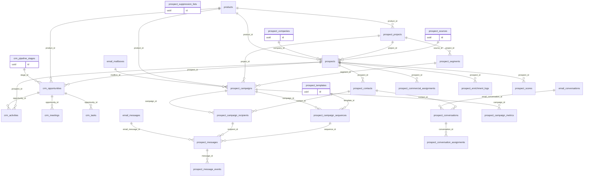

## L. Email Center

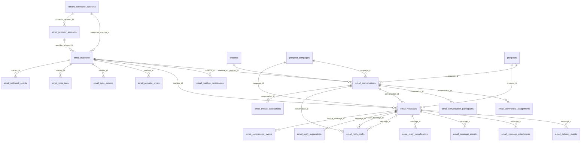

## N. Growth Intelligence

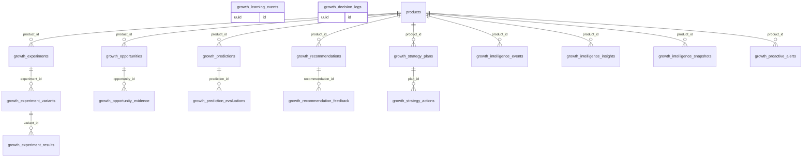

## O. THOR

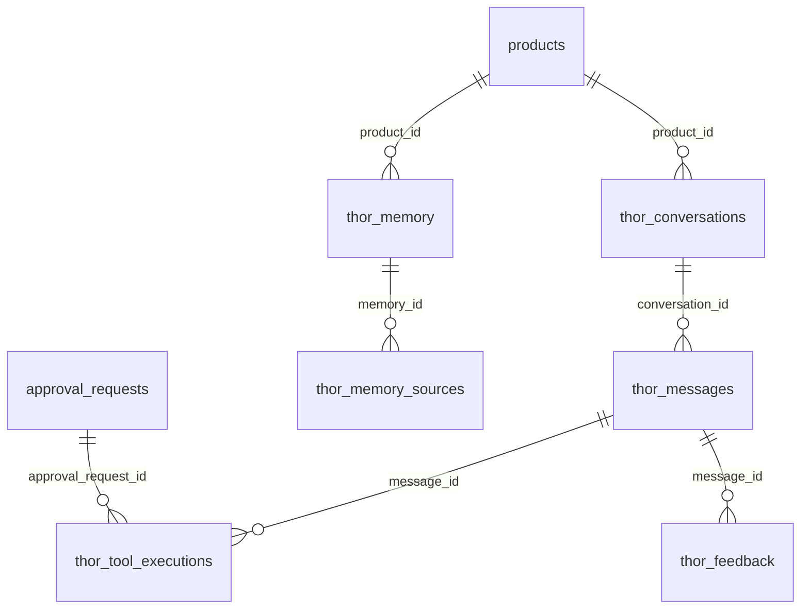

## L2. WhatsApp Center

```mermaid
erDiagram
    prospect_contacts ||--o{ whatsapp_contacts : prospect_contact_id
    tenant_connector_accounts ||--o{ whatsapp_accounts : connector_account_id
    whatsapp_accounts ||--o{ whatsapp_conversations : account_id
    whatsapp_accounts ||--o{ whatsapp_templates : account_id
    whatsapp_accounts ||--o{ whatsapp_webhook_events : account_id
    whatsapp_contacts ||--o{ whatsapp_conversations : contact_id
    whatsapp_conversations ||--o{ whatsapp_messages : conversation_id
```

## V. Visibilité

```mermaid
erDiagram
    products ||--o{ visibility_profiles : product_id
    visibility_audits ||--o{ tenant_roadmap_items : audit_id
    visibility_audits ||--o{ visibility_generated_assets : audit_id
    visibility_audits ||--o{ visibility_recommendations : audit_id
    visibility_profiles ||--o{ ai_visibility_questions : profile_id
    visibility_profiles ||--o{ visibility_audits : profile_id
    visibility_profiles ||--o{ visibility_recommendations : profile_id
    visibility_recommendations ||--o{ visibility_generated_assets : recommendation_id
```

